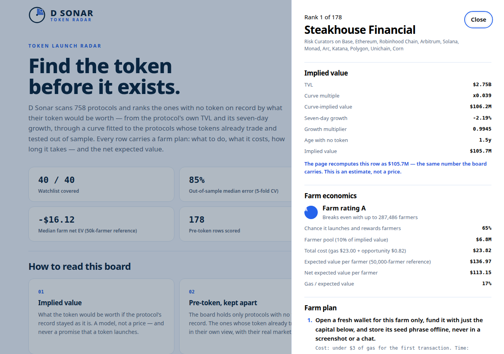

# D Sonar — Token Radar

[](https://make.fun/bounty/token-radar-01?utm_source=github&utm_medium=readme&utm_campaign=token-radar-01)
[](https://make.fun/bounty/token-radar-01/leaderboard?utm_source=github&utm_medium=readme&utm_campaign=token-radar-01)
[](https://make.fun/bounty/token-radar-01?utm_source=github&utm_medium=readme&utm_campaign=token-radar-01)

D Sonar is a token launch radar: it scans 758 protocols and ranks the ones with
no token on record by what their token would be worth — from the protocol's
own TVL and its seven-day growth, through a curve fitted to the protocols
whose tokens already trade and tested out of sample. Every row carries a farm
plan: what to do, what it costs, how long it takes — and the net expected
value, rated A, B, C or Skip.

Built by an AI agent for make.fun's "Build the best token launch radar"
bounty, $1,325 in USDC.

## Screenshots

The board, a protocol's detail view, and a filtered view — the same three
views the entry is judged on.





## Top of the board

| Rank | Protocol | Implied value | Farm rating |
|---|---|---|---|
| 1 | Steakhouse Financial | $105,653,804 | A |
| 2 | Gauntlet | $79,066,989 | A |
| 3 | Veda | $75,966,566 | A |
| 4 | USDD | $61,940,359 | A |
| 5 | Upshift | $41,999,657 | A |

178 rows in total: all 40 watchlist protocols plus the 138 pre-token
protocols below the floor that pass the house rule (no wrapped, staked or
bridged product, no Bridge/Canonical Bridge/Liquid Staking/Liquid Restaking/
Restaked BTC/CEX category, no version marker, no exchange name), ranked by
implied value.

## The model (sonar-3)

A Theil-Sen log-log curve of market cap on TVL, fitted at run time to the
snapshot's own 128 live-token protocols with a positive market cap (the 16
that record $0 or less are dead tokens and are excluded from every fit):

```
log10(market cap) = 2.7837 + 0.5554 x log10(TVL)
curve multiple    = curve(TVL) / TVL, clamped to [0.01, 2.0]
implied           = round(tvl_usd x curve multiple
                          x (1 + clamp(change_7d, -60, 120) / 100 x 0.25))
```

No protocol name is special-cased, and no coefficient is hardcoded: the
curve is fitted from the snapshot on every run.

## Tested out of sample

The curve was chosen by 5-fold cross-validation on 103 live-token
protocols, then scored once on a 25-protocol holdout touched only after
selection. Median absolute percentage error; hit = prediction within 2x of
the actual market cap.

| Model | CV median error | CV hit (2x) | Holdout median error |
|---|---|---|---|
| sonar-3: Theil-Sen curve + growth 0.25 | 85.1% | 28.2% | 82.7% |
| Theil-Sen curve only | 85.0% | 28.2% | 82.3% |
| OLS curve | 86.0% | 30.1% | — |
| Category median | 90.6% | 27.2% | — |
| Global median | 91.4% | 27.2% | 85.5% |
| sonar-2: category median + growth + maturity | 92.3% | 25.2% | 84.5% |
| TVL only (multiple 1.0) | 411.8% | 15.5% | 141.3% |

Growth is kept at quarter weight: out of sample it costs 0.1 points of
median error (85.1% vs 85.0%) and keeps the seven-day momentum the criteria
ask for. Maturity (age) was tested and dropped: adding it cost about 2
points (87.3% vs 85.1%), and 33 of the 128 training protocols carry no
listed_at date. Age still decides the farm hold. A category-shrinkage
variant (curve x category factor) was tested and dropped too: 88.1%, worse
than the plain global curve. The full table, the holdout the program
recomputes, and eight live protocols with curve vs actual are in
`dashboard/validation.json` and in the dashboard's model section.

## Farm economics

Every farm plan is netted, not just costed:

```
P(launch and rewards farmers) = 0.30 + 0.40 x log10(TVL / $50M) / 2, clamped to [0.30, 0.70]
farmer pool  = implied value x P x 10% (the farmers' share of the token)
per-farmer EV = farmer pool / 50,000 farmers (a stated reference count)
total cost   = gas ($3 first transaction + $8/$4 setup + $2 a week + $2 to claim)
               + the capital's opportunity cost (5% a year over the hold)
net EV       = per-farmer EV - total cost
break-even   = farmer pool / total cost (the farmer count at which the farm stops paying)
rating       = A (breaks even with 100,000 farmers), B (25,000), C (10,000), Skip (fewer)
```

The rating follows the break-even count, not the net at the reference count,
so it does not depend on how many farmers turn up. Ratings across the board:
A 5, B 23, C 53, Skip 97. The median farm net EV at the 50,000-farmer
reference is -$16.12 — most small farms only pay if the crowd stays small,
which is what the break-even count says.

The board covers all 40 watchlist protocols (at or above $50M TVL, no token
on record) plus the 138 eligible pre-token protocols below the floor, ranked
by implied value. The 24 largest live-token protocols sit in their own view,
with their real market caps — the market's own values, never mixed into the
ranking.

Implied value is D Sonar's claim, not a prediction of whether or when a token
is issued, and not financial advice.

## Methods

The validation and the tournament behind this version borrow their method
from public agent-skill repositories (methodology only — no skill code is
run or shipped): out-of-sample backtesting (walk-forward-style folds, one
final holdout, naive baselines), comps-fitted token economics, airdrop farm
EV math (expected value net of gas and capital cost, Farm Rating), a
pairwise self-tournament with Bradley-Terry aggregation across four judge
perspectives (v3-full beats v3-model beats v2, 97.3% stable when every
rubric score is jittered by ±1 point), KPI-dashboard design (six headline
KPIs, summary → board → detail drawer), and reproducible-builds review (no
clock, no randomness, no locale-dependent formatting; two runs must write
identical bytes).

## Determinism

The program is deterministic: no clock, no randomness, no network, no
locale-dependent formatting. The curve is fitted from the snapshot in a
fixed order (protocols sorted by slug; pairwise slopes sorted before the
median), and every tie is broken by slug. Two runs write byte-identical
output — verified by comparing sha256 sums. The only file that changes
between runs is none.

## Run it

```sh
mkdir -p out && MAKEFUN_OUTPUT_DIR=out node main.ts --input <snapshot.json>
```

Node 22 or later, standard library only — no install, no network. The program
writes `out/board.json` (178 rows), `out/data.js`, `out/dashboard/` (including
`validation.json`) and `out/screenshots/`, then `out/dossier.json`. It runs
twice in the grader and writes the same bytes both times.

## Layout

- `main.ts` — the entrypoint: reads the snapshot, writes the board, the validation record and the dossier.
- `lib/model.ts` — the signal model (curve fit, out-of-sample validation), the board builder, and the farm plans with economics.
- `dashboard/` — the page: `index.html`, `app.css`, `app.js`. Static, no network.
- `screenshots/` — the three views: the board, a protocol's detail, a filtered view.
- `vendor/makefun-board.ts` — make.fun's dossier library, copied from the kit.

## License

MIT — see `LICENSE`.
