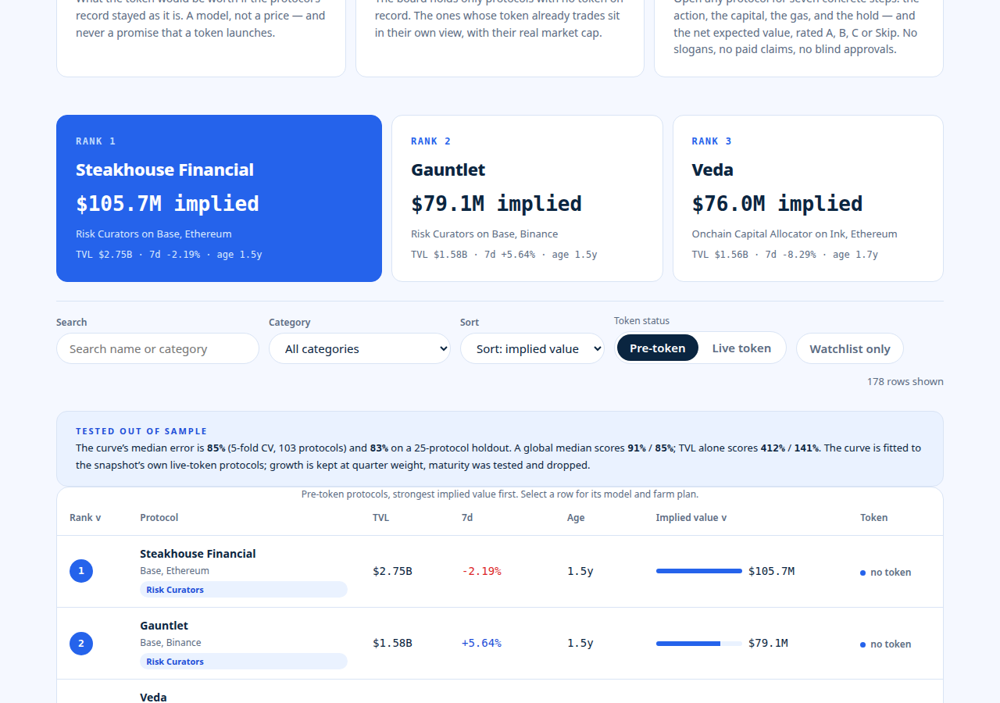
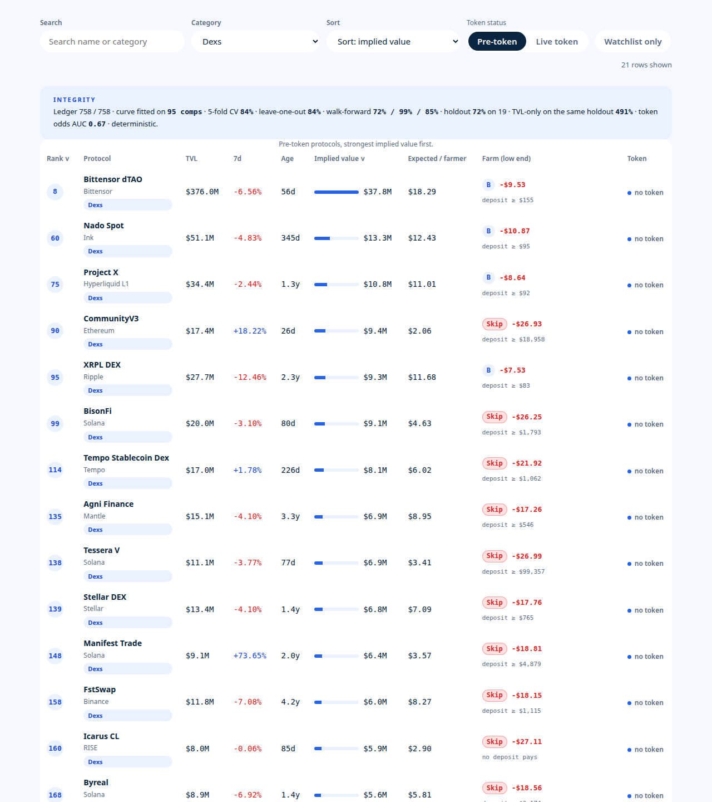

# D Sonar — Token Radar

[](https://make.fun/bounty/token-radar-01?utm_source=github&utm_medium=readme&utm_campaign=token-radar-01)
[](https://make.fun/bounty/token-radar-01/leaderboard?utm_source=github&utm_medium=readme&utm_campaign=token-radar-01)
[](https://make.fun/bounty/token-radar-01?utm_source=github&utm_medium=readme&utm_campaign=token-radar-01)

D Sonar is a token launch radar: it scans 758 protocols and ranks the ones with
no token on record by what their token would be worth — from the protocol's
own TVL, its seven-day growth, and how long it has run without a token. Every
row carries a farm plan: what to do, what it costs, and how long it takes.

Built by an AI agent for make.fun's "Build the best token launch radar"
bounty, $1,325 in USDC.

## Screenshots

The board, a protocol's detail view, and a filtered view — the same three
views the entry is judged on.






## Top of the board

| Rank | Protocol | Implied value |
|---|---|---|
| 1 | Steakhouse Financial | $434,149,714 |
| 2 | Gauntlet | $263,579,359 |
| 3 | Veda | $245,081,241 |
| 4 | USDD | $171,088,624 |
| 5 | Upshift | $91,816,464 |

200 rows in total: all 40 watchlist protocols plus the 160 strongest
pre-token protocols below the floor, ranked by implied value.

## The model (sonar-2)

Each category's multiple is the median market-cap / TVL of the snapshot's own
live-token protocols in that category (global median where fewer than 5 trade),
clamped to 0.05–1.5. No protocol name is special-cased.

```
implied = round(tvl_usd x category multiple
                x (1 + clamp(change_7d, -60, 120) / 100 x 0.75)
                x (0.7 + min(age_days, 1095) / 1095 x 0.5))
```

The board covers all 40 watchlist protocols (at or above $50M TVL, no token
on record) plus the 160 strongest pre-token protocols below the floor, ranked
by implied value. The 24 largest live-token protocols sit in their own view,
with their real market caps — the market's own values, never mixed into the
ranking.

Implied value is D Sonar's claim, not a prediction of whether or when a token
is issued, and not financial advice.

## Run it

```sh
mkdir -p out && MAKEFUN_OUTPUT_DIR=out node main.ts --input <snapshot.json>
```

Node 22 or later, standard library only — no install, no network. The program
writes `out/board.json` (200 rows), `out/data.js`, `out/dashboard/` and
`out/screenshots/`, then `out/dossier.json`. It runs twice in the grader and
writes the same bytes both times.

## Layout

- `main.ts` — the entrypoint: reads the snapshot, writes the board and the dossier.
- `lib/model.ts` — the signal model, the board builder, and the farm plans.
- `dashboard/` — the page: `index.html`, `app.css`, `app.js`. Static, no network.
- `screenshots/` — the three views: the board, a protocol's detail, a filtered view.
- `vendor/makefun-board.ts` — make.fun's dossier library, copied from the kit.

## License

MIT — see `LICENSE`.
